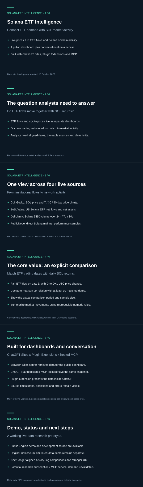

# Solana ETF Intelligence — Pitch Deck

**Current live-data development version · 10 October 2026**

[Open the public English demo](https://solana-etf-intelligence-dev.tinybee3.chatgpt.site/review) · [Source code](https://github.com/mitsuhitokawada/solana-etf-intelligence-dev)

## Readable slide text

### 1. Solana ETF Intelligence

**Connect ETF demand with SOL market activity.**

- Live prices, US ETF flows and Solana onchain activity.
- A public dashboard plus conversational data access.
- Built with ChatGPT Sites, Plugin Extensions and MCP.

Live-data development version | 10 October 2026

### 2. The question analysts need to answer

**Do ETF flows move together with SOL returns?**

- ETF flows and crypto prices live in separate dashboards.
- Onchain trading volume adds context to market activity.
- Analysts need aligned dates, traceable sources and clear limits.

For research teams, market analysts and Solana investors

### 3. One view across four live sources

**From institutional flows to network activity.**

- CoinGecko: SOL price and 7 / 30 / 90-day price charts.
- SoSoValue: US Solana ETF net flows and net assets.
- DefiLlama: Solana DEX volume over 24h / 7d / 30d.
- PublicNode: direct Solana mainnet performance samples.

DEX volume covers tracked Solana DEX tokens; it is not net inflow.

### 4. The core value: an explicit comparison

**Match ETF trading dates with daily SOL returns.**

- Pair ETF flow on date D with D-to-D+1 UTC price change.
- Compute Pearson correlation with at least 10 matched dates.
- Show the actual comparison period and sample size.
- Summarize market movements using reproducible numeric rules.

Correlation is descriptive. UTC windows differ from US trading sessions.

### 5. Built for dashboards and conversation

**ChatGPT Sites x Plugin Extensions x hosted MCP.**

- Browser: Sites server retrieves data for the public dashboard.
- ChatGPT: authenticated MCP tools retrieve the same snapshot.
- Plugin Extension presents the data inside ChatGPT.
- Source timestamps, definitions and errors remain visible.

MCP retrieval verified. Extension question sending has a known composer error.

### 6. Demo, status and next steps

**A working live-data research prototype.**

- Public English demo and development source are available.
- Original Colosseum simulated-data demo remains separate.
- Next: longer aligned history, lag comparisons and stronger UX.
- Potential research subscription / MCP service; demand unvalidated.

Read-only RPC integration; no deployed onchain program or trade execution.

## Submission context

[Original Colosseum project](https://colosseum.com/arena/projects/solana-etf-intelligence) was submitted with a simulated-data prototype. This deck describes the separate live-data development version and does not imply the original videos demonstrate it.

This project reads Solana mainnet through RPC; it does not deploy an onchain program. Track eligibility is determined by the organizers.
